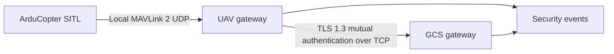

# Phase 3: Secure Communication Gateway

**Status:** Architecture and acceptance plan

**Repository baseline:** `b347f94` on `main`

**Milestone:** Deliver authenticated, read-only ArduCopter SITL telemetry to a
GCS service. Keep gateway security independent of Streamlit.

## Trust boundaries and message flow

The UAV gateway receives local SITL telemetry. When signing is enabled, it
verifies MAVLink frames before calling the existing telemetry normalizer.
MAVLink signing provides message authentication and integrity while leaving
telemetry readable on the local UDP leg. Mutual TLS protects the separate
TCP connection and authenticates both gateways. The GCS gateway consumes
validated telemetry. The first release forwards telemetry only. Mission
authorization remains a separate Phase 4 concern.

The prototype trusts the simulator, gateway processes and hosts, local
development CA, and provisioned credentials. A verified TLS identity proves
which gateway connected. A valid MAVLink signature establishes possession
of the relevant shared secret. System and component IDs are routing fields.
Host compromise, compromised signing keys in use, and falsified simulator
position sources are outside this experiment.

Reuse [the threat model](threat_model.md) and [the protocol design](protocol_design.md).
This phase brings MAVLink signing forward as a separately measured configuration.
The TLS stack handles transport encryption and key negotiation. Separate application
payload encryption needs a distinct confidentiality requirement and is deferred.

## Repository placement and interfaces

| Path | Responsibility |
|---|---|
| `simulator/mavlink_adapter.py` | Reuse `open_receiver(port)` and `normalize(message)`. Add signed-receive support only when the signing milestone requires it. |
| `simulator/telemetry_collector.py` | Keep the existing read-only collector, CLI, and evidence format available as the Phase 2 baseline. |
| `gateways/uav_gateway.py` | Own the SITL receiver, signature policy, and forwarding to the GCS. |
| `gateways/gcs_gateway.py` | Listen for the authorized UAV gateway and consume validated telemetry. |
| `security/tls_context.py` | Build client and server TLS contexts and enforce peer identity policy. |
| `security/mavlink_signing.py` | Configure pymavlink signing and manage signing-state persistence. |
| `security/audit.py` | Emit structured security events with redacted details. |
| `tests/integration/` | Verify loopback mutual TLS first, then verify relay behavior with SITL. |

Use the plural `gateways/` directory for new gateway code. Update the existing
lowercase `docs/threat_model.md` if implementation changes the assumptions.
Keep local development keys outside the checkout.

## First implementation task: loopback mutual TLS

1. Create the two gateway entry points and shared TLS context code. In this
   slice, the UAV gateway is the client and the GCS gateway is the server.
   Bind to loopback and send a fixed synthetic telemetry record.
2. Use Python's `ssl` module and explicit development CA trust. Require
   TLS 1.3 and certificates on both ends. The UAV client verifies the GCS
   server name against its certificate. The GCS server explicitly checks the
   UAV certificate identity against its configured allowlist after chain
   validation and before reading application data. Use separate client and
   server identities and appropriate certificate purposes.
3. Use newline-delimited UTF-8 JSON for the first slice. Bound each record
   to 64 KiB and give connection, handshake, and record reads finite timeouts.
   Reject oversized, invalid, or incomplete records and close the session.
   On network interruption, reconnect with bounded retry delay. Treat
   identity failures as configuration errors and log the reason category.
4. Generate ephemeral development credentials for tests. Test one successful
   record transfer and verify that missing, untrusted, expired, or wrong
   identities deliver zero application records. Also test wrong server name
   and reconnect after a clean server restart.
5. Capture negotiated TLS version, authenticated peer role, accepted record
   count, and error categories as review evidence.

The synthetic record should carry a schema version, vehicle ID, message type,
capture time, and normalized values. Validate identity and record shape before
trusting fields. Never log private keys, signing secrets, or raw payloads.

## Remaining milestones and acceptance

| Milestone | Pass evidence |
|---|---|
| Mutual TLS and identity | The authorized client sends one record over TLS 1.3. Missing, untrusted, expired, and wrong peer identities fail closed. |
| SITL integration | A fresh stationary run reaches the GCS through the gateway and includes heartbeat and position records. The Phase 2 collector still passes its existing tests on its own run or receive port. |
| MAVLink signing | Pymavlink accepts valid signed fixtures and rejects unsigned, integrity-invalid, and wrong-key fixtures in strict mode. Confirm ArduCopter telemetry reaches the gateway with strict signing enabled. Treat signed SITL forwarding as unverified until observed. |
| Freshness and replay | Verify rejection of duplicate, stale, and out-of-order signed fixtures under the documented policy. Define signing timestamp persistence and recovery across gateway and SITL restarts. Keep MAVLink frame replay separate from any later mission request deduplication. |
| Credential lifecycle | Provision separate certificate and MAVLink credentials. Verify rotation and show old credentials are denied under the new configuration. For the local CA, define removal of old identities or explicit denylisting and how active sessions are handled. |
| Audit | Record authentication, rejection, link interruption, recovery, and credential-change events. Verify records include timestamps and identity or connection references, with secret and payload fields omitted. Use a coarse rejection category when the underlying library lacks a precise reason. |
| Performance | Measure handshake time and record-processing latency separately. Record the platform, revision, message count, and p50/p95 for a repeatable stationary workload. |
| Release review | Report findings and limitations alongside unit and integration test results. Record what passed under real local SITL and what was tested only with fixtures. |

Run the existing suite before the first code change. Add loopback TLS integration
tests with the first implementation and rerun the full suite before joining
the gateway to SITL.

## References

- [MAVLink 2 signing](https://mavlink.io/en/guide/message_signing.html)
- [Pymavlink message signing](https://mavlink.io/en/mavgen_python/message_signing.html)
- [Python 3.12 TLS contexts and certificate validation](https://docs.python.org/3.12/library/ssl.html)
