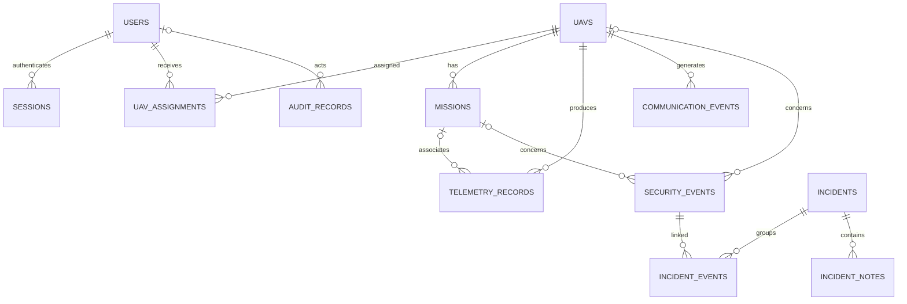

# Phase 5 — Database Management and Secure Storage

Status: Architecture proposed after source review. Implementation and validation pending.
Baseline: commit 0ead524, supplied source archive. User-reported Windows baseline: 73 tests and 21 subtests passed. This review did not rerun that suite.

## 1. Scope and existing implementation

Extend the Phase 4 database without replacing users, passwords, assignments, sessions or authorization rules. Preserve the Phase 3 signing verifier and mTLS gateway.

The reviewed `database/identity_database.py` uses SQLite schema version 4 (`PRAGMA user_version`). Connections enable foreign keys, use a 10-second busy timeout, and return named rows. Initialization uses BEGIN IMMEDIATE and transactional migrations from versions 0–3. It rejects unknown schema versions and unrelated nonempty databases.

Existing tables:

| Area | Existing tables | Phase 5 action |
|---|---|---|
| Identity | roles, permissions, role_permissions, users | Preserve |
| Vehicle identity | uavs, uav_assignments | Preserve; retain assignment changes in audit |
| Authentication | sessions, login_attempts | Preserve; add documented cleanup rules |
| Policy | policies | Preserve mission-area authorization configuration |
| Audit | identity_events, authorization_events | Preserve; expose through common authorized event queries |
| Telemetry | telemetry_snapshots | Preserve latest-value behavior; add historical records |
| Commands | command_requests | Preserve dispatch semantics and status history requirements |

`RegistryGuard` currently checks certificate URI, active registry status, system ID and signing-key fingerprint, then updates the snapshot and records the ingestion decision in one transaction. `PolicyEngine` checks current session, role and assignment before reading snapshots. These enforcement points must remain effective.

Separate SQLite files hold signing replay watermarks and credential audit state. Do not move or reset these automatically during the application schema migration. Their state and recovery requirements differ from ordinary telemetry retention.

## 2. Checklist coverage after source review

| Stage | Existing foundation | Remaining work |
|---|---|---|
| 5.1 Architecture | Phase 4 identity model | This proposal, ER diagram and agreed retention/access rules |
| 5.2 Setup | Connections, initialization, schema versioning, transactions | Explicit incremental migration modules; failure tests and operational configuration |
| 5.3 Telemetry | Latest heartbeat/position snapshots; collector CSV | History, time-range queries, missing fields, source/validation metadata |
| 5.4 Security events | Identity/authorization tables; separate logs | Central typed events, severity, filtering and gateway event integration |
| 5.5 UAV/mission | Registry and assignments | Mission lifecycle/history and explicit telemetry association |
| 5.6 Audit | Login, administration and decision events | Common retrieval, mission/storage events and modification restrictions |
| 5.7 Incidents | No incident storage in identity schema | Incidents, event links, notes and transitions |
| 5.8 Reliability | Parameterized queries and foreign keys in reviewed paths | Backup/restore, retention, file protection checks, concurrent workloads |
| 5.9 Interfaces | Python service APIs | Authorized repository/service interfaces; separately tested HTTP adapter |
| 5.10 Validation | Existing baseline tests | Phase 5 migration, integrity, access, restore, concurrency and load evidence |
| 5.11 Documentation | Existing Phase 4 docs | Final schema/API/runbook/performance/closeout documents |

## 3. Target schema

Use stable UUID text identifiers except the existing integer audit IDs. Store UTC event times consistently as integer microseconds for new tables; serialize them as ISO 8601 UTC at interface boundaries. Keep existing timestamp formats intact and normalize them when reading through the common interface.

### missions

- mission_id TEXT primary key; uav_id TEXT not null foreign key to uavs.
- name TEXT not blank; details_json TEXT containing validated bounded JSON.
- status constrained to planned, active, completed, cancelled, failed.
- created_by TEXT foreign key to users; created_at_us INTEGER not null.
- started_at_us and ended_at_us nullable INTEGER; end cannot precede start.
- Unique (mission_id, uav_id) supports composite telemetry references.
- Partial unique index allows at most one active mission per UAV.
- Starting/closing a mission and its audit event commit atomically.
- Recording a mission does not dispatch a flight plan or imply a successful flight.

### telemetry_records

- record_id TEXT primary key, copied from the validated gateway record.
- uav_id TEXT not null foreign key to uavs; mission_id nullable.
- Composite foreign key (mission_id, uav_id) references missions(mission_id, uav_id).
- captured_at_us and received_at_us INTEGER not null; source_boot_ms nullable.
- message_type, system_id, component_id, source and validation_status not null.
- Source identifies actual origin, e.g. ardupilot_sitl; validation status identifies the accepted gateway verification stage.
- Optional normalized latitude_deg, longitude_deg, altitude_msl_m, relative_altitude_m, groundspeed_mps, battery_remaining_pct, flight_mode and armed fields.
- Validated bounded payload_json preserves message-specific values and signing-key identifier, never signing secrets.
- Latitude/longitude ranges, finite numeric values, battery 0–100 and armed 0/1 are validated. Unknown values remain NULL.
- Index (uav_id, captured_at_us, record_id), plus mission/time index.
- Duplicate ID with identical content is idempotent; conflicting content is rejected and audited. Record-ID deduplication is separate from cryptographic replay verification.
- History insertion, snapshot update and acceptance audit commit in the same transaction before acknowledgement. A retry for an already committed identical record can receive an acknowledgement without creating another record.
- No historical reconstruction from snapshots. Optional existing JSONL/CSV imports must retain provenance and must not claim newly verified signatures.

### communication_events

Store event_id primary key, uav_id nullable foreign key, occurred_at_us, state (connected, lost, recovered, offline), source and bounded reason. Derive current communication status from fresh observed events/heartbeats, never merely from an existing snapshot.

### security_events

Store event_id primary key, occurred_at_us, ingested_at_us, producer, producer_event_id, category, severity (info, low, medium, high, critical), outcome, actor_id nullable, uav_id nullable foreign key, mission_id nullable foreign key, correlation_id and bounded redacted details_json.

Enforce unique (producer, producer_event_id) for reliable ingestion deduplication. Index time, category/time and uav/time. Unauthenticated or unmapped sources can have NULL UAV IDs with untrusted claimed IDs only inside bounded details. Claimed IDs must not create registry entries.

Integrate authentication, authorization, MAVLink rejection, replay/freshness rejection, TLS authentication/connection and credential-change events. Retain legacy identity/authorization rows and expose them using source-qualified IDs through the event service. Avoid duplicating legacy events during migration. New adapters may project legacy rows into unified query results before full producer migration.

### audit_records

Store audit_id primary key, occurred_at_us, actor_id nullable, actor_kind, action, target_type, target_id, result, reason and correlation_id. Application administrative/mission/data mutations and their audit entries commit atomically. Failed operations record a failure event after rollback in a separate bounded transaction when possible. A storage outage cannot guarantee that its own failure is recorded in the same unavailable database.

### incidents and incident relationships

Incidents contain incident_id primary key, title, attack_category, severity, status (open, investigating, resolved), created_at_us, updated_at_us, created_by, assigned_to nullable, resolved_at_us and resolution nullable. User references point to users. Resolution requires nonblank resolution details.

incident_events links incident_id and security_event_id with a composite primary key and foreign keys. incident_notes contains note_id primary key, incident_id/user foreign keys, created_at_us and bounded plain-text note. Changes and notes produce audit records. Reopening requires an explicit audited operation.

## 4. ER diagram

The diagram shows principal relationships; schema documentation must also enumerate all existing permission tables and constraints. Telemetry-to-mission association is optional and must match the UAV.

## 5. Access and interfaces

Repositories execute parameterized SQL inside caller-owned transactions. They do not authenticate users themselves and are internal implementation details. Public Python services and HTTP handlers must authorize every operation before repository access, rechecking session, current account, role, UAV state and assignment in the same transaction where practical.

Preserve Administrator/Operator/Viewer roles. All roles require UAV assignment for protected UAV telemetry and mission reads. Administrator manages missions, incidents, backups, retention and global security/audit retrieval. Operators retain their existing own-event access; Viewers receive assigned telemetry/status only. New permissions must be seeded explicitly by migration, never inferred from visible UI controls.

Planned Python services: telemetry ingest/query, mission lifecycle/history, security event query, audit query, incident lifecycle, backup and retention. Time filters use [from, to); bounded page size defaults 100, maximum 1000. Stable cursors use timestamp plus ID; filters and sort fields are allowlisted.

Stage 5.9 includes a separate HTTP adapter suitable for eventual Vercel integration. Document and test its endpoints only after implementation. It must use the existing server-side authentication and authorization services, TLS outside loopback, explicit allowed origins, no tokens in query URLs and no client-selected arbitrary database paths. Browser cookie/session and CSRF handling must be defined before integration. The current frontend is not presumed connected.

## 6. Telemetry producer gaps

The current secure live schema forwards HEARTBEAT and GLOBAL_POSITION_INT. It does not supply the entire checklist. Extend the collector callback, signed forwarding schema, validator and GCS storage together to include battery messages and a documented flight-mode representation from heartbeat metadata. Derive horizontal speed from signed position velocity or ingest an explicitly validated speed source. Store provenance and units.

Do not fabricate battery, mode, communication status or live connectivity when unavailable. Each historical row reflects its actual source message; a latest-value display can combine independently timestamped fields only when their ages remain visible.

Mission ID must be assigned through authorized server-side mission state, not accepted blindly from a client field. Offline samples retain their actual capture time and must not overwrite newer latest-value snapshots.

## 7. Migration and implementation order

1. Add migration tests for a populated version-4 database and capture a verified backup before any real upgrade.
2. Refactor initialization into sequential versioned migrations while preserving the existing entry point and version-0–4 behavior. Keep migrations atomic; update user_version only on success. Guard concurrent initialization. Do not modify existing versions in place after release.
3. Add missions, telemetry history and communication events. Integrate accepted gateway writes, extend source coverage and implement authorized queries.
4. Add central security/audit storage and producer adapters without resetting signing state.
5. Add incident service, filtering and pagination.
6. Implement backup/restore and explicit retention, then HTTP adapter and integration tests.
7. Complete validation report and checklist with actual results and remaining limitations.

Choose the exact next schema version when implementing the first migration. Do not edit the production database using ad hoc manual ALTER statements. Preserve all existing user/UAV IDs, permissions, assignments, active session records, policies, command state and latest snapshots during upgrade. New history starts at deployment, with legacy imports explicitly labeled if added later.

## 8. Reliability, retention and recovery

Proposed initial development policy, configurable and documented before enabling deletion:

| Data | Retention |
|---|---|
| Telemetry history and communication events | 30 days |
| Security events | 180 days; incident-linked events retained while incident retained |
| Audit, missions, incidents and notes | Retain through research review; explicit Administrator archival required |
| Expired/revoked sessions | 7 days after expiry/revocation, subject to command-request FK dependencies |
| Backups | Daily backups, keep 7 daily and 4 weekly copies |
| Replay watermarks | No time-based pruning during this phase |

Retention defaults to preview/dry-run. Deletion is bounded, transactional and audited; enforce dependent incident links and foreign keys. Export anonymized research evidence before planned deletion. These are proposed defaults, not existing automatic jobs.

Use SQLite's online backup mechanism for a consistent snapshot. Do not copy a live database file alone when WAL may be active. Check integrity and foreign keys, write a manifest with schema version/hash/counts, and test restoration to a separate destination. Never overwrite a running database. Restore requires maintenance mode, no active writers and a pre-restore backup.

Evaluate WAL on the actual deployment filesystem before enabling it. The current Windows/WSL shared-file access must be tested explicitly; never assume WAL and cross-environment file locking are compatible. Prefer one OS-owned database service boundary. Measure concurrency under the chosen journal mode and handle busy/locked errors with bounded retries only for safe operations.

Restoring older application state must invalidate restored sessions before traffic resumes and reconcile queued commands to prevent accidental redispatch. Signing watermark state has a separate anti-rollback recovery procedure; do not restore an old watermark database as if it were ordinary history. Test backup behavior and restart state explicitly.

Protect directories and backups with OS permissions; do not commit database files or credentials. Passwords remain Argon2id hashes; sessions remain token hashes. Store no private signing/TLS keys or plaintext passwords in event payloads. Existing SQLite files are not encrypted at rest. Database-file encryption is outside this initial plan unless separately implemented and tested; record that limitation in the completion report.

SQLite does not provide per-user SQL roles in this application. Role enforcement is in backend services. Ordinary application users have no audit modification operation; OS/database-file administrators remain trusted and can modify files. Do not claim tamper-proof logs.

## 9. Acceptance evidence

- Initialization and all supported upgrade paths preserve populated baseline records; interrupted migration rolls back and future versions fail safely.
- Gateway history/snapshot/audit consistency holds on success, malformed payload, duplicate/conflicting ID and storage failure. No success acknowledgement precedes required committed storage.
- Telemetry contains actual source fields with units, source and validation stage; queries enforce UAV assignment, time range, ordering and page bounds.
- Unknown/unregistered/inactive UAVs cannot insert accepted telemetry. Missing fields remain unknown rather than fabricated.
- Mission transitions, timestamps and cross-UAV relationships reject invalid input.
- Signing/replay/TLS failures reach centralized storage without secret leakage; event retries are idempotent.
- Incident transitions, linked events and resolution notes persist with authorized access and audit records.
- Invalid/revoked sessions, changed roles and removed assignments deny access through Python and HTTP entry points; ordinary users cannot modify audit rows through supported services.
- Parameter injection, oversized inputs, nonfinite values and invalid timestamps are rejected safely.
- Concurrent writers/readers, lock contention and process restarts produce no partial logical writes.
- Backup plus restore verifies integrity, relationships and representative queries, and session/command/replay rollback safeguards.
- Retention dry-run/deletion respects incident links and produces an audit record.
- Benchmark insertion/query latency and lock failures with explicit record counts, concurrency, hardware/filesystem, journal mode and percentiles. Report measurements, not assumed thresholds or wireless claims.
- Run the full regression suite; save exact output. Complete a fresh SITL-to-storage-to-authorized-history-read trial and document its run ID.

## 10. Planned files and deliverables

Preserve `database/identity_database.py` as a compatibility entry point. Add incremental migrations under `database/migrations/`, focused repositories under `database/repositories/`, and authorized storage services under `backend/storage/`. Add tests under existing unit/integration directories. Exact file names are finalized with each patch.

Documentation deliverables: this architecture/ER proposal, schema reference, implemented service/HTTP API reference, backup/recovery runbook, retention policy and Phase 5 validation report. No Phase 5 completion claim is justified until implementation and evidence satisfy the checklist.
