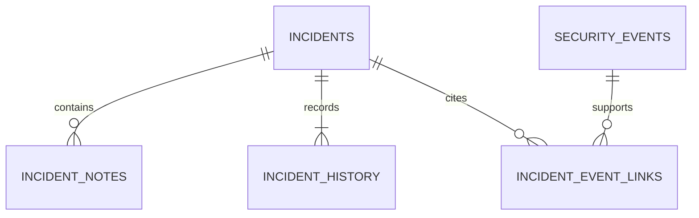

# Phase 5.7: Security incident management

Baseline: commit `35bd0fd`, identity schema 9. This patch introduces schema 10.
Status: implemented and locally tested; Windows regression and deployment checks
remain pending when the patch is delivered.

## Checklist mapping

| Requirement | Implementation |
|---|---|
| Create incident records | UUID incident ID, title, description, creator and timestamps |
| Attack-type categorization | Validated classification, with audited reclassification |
| Severity | info, low, medium, high or critical |
| Link security events | Foreign-key evidence links to existing central security events |
| Open, Investigating, Resolved | Explicit lifecycle with required resolution details |
| Investigation notes/resolution | Persistent notes and resolution, with actor/time history |

This is manual case management. An administrator selects evidence and records
an investigation. Classification/severity express that administrator's assessment;
they do not establish that an attack occurred. No AI detector, automatic incident
creation, flight response, frontend controls or deployed HTTP API is added here.

## Schema



`incidents` stores `incident_id`, optional `uav_id`, `title`, `description`,
`attack_type`, `severity`, `status`, `created_by`, `created_at_us`,
`updated_at_us`, `resolved_at_us` and `resolution`. UTC times are integer
microseconds. UAV references use the existing registry; no duplicate UAV
identity store is created. Indexes support creation-time, status and UAV queries.

`incident_event_links` stores a unique incident/security-event pair, link ID,
actor and link time. The evidence remains in `security_events`; it is not copied
into a case as a disconnected snapshot. Foreign keys prevent deletion of a
security event while it is linked. Future retention must respect these links.
A trigger prevents reassignment of existing links.

`incident_notes` stores the case, note ID, actor, time and bounded text.
`incident_history` stores append history with actor/time/action and bounded
structured change details. History includes creation, evidence linking, note
addition, status changes and reclassification. Note contents/resolution text
are not duplicated into the central security log. Central category `incident`
events contain action metadata and the known actor/incident/UAV identifiers.

Each supported mutation, history entry, central event and successful
authorization audit commits together. An error rolls back the transaction.
Known business denials are separately recorded as authorization denials within
the request transaction. As elsewhere, a database outage can prevent auditing;
this is not a guarantee of event persistence while storage is unavailable.

Migration 10 preserves schema-9 data, including missions, telemetry and security
events. It creates no retrospective incidents and is idempotent when initialization
is repeated. No runtime database, credentials or backups belong in Git.

## Authorization and evidence scope

Incident operations require a current active Administrator session and the
existing `audit.read` permission. This restriction applies to reads and writes,
including CLI requests. Operators (even with their own-audit access), Viewers,
expired/revoked sessions and revoked accounts are denied. Current role and
permission changes take effect on the next request.

Cases can contain organization-wide security evidence, so incident access follows
the administrator audit boundary rather than command/telemetry assignments.
Administrators may investigate registered UAVs that are suspended or revoked.
This does not grant telemetry/flight-command access to those UAVs.

For a UAV-specific case, linked events must refer to that UAV or have no UAV
attribution (for example, a TLS handshake rejected before identity was known).
A system-wide case with null UAV ID may link events across UAVs. Unknown event
IDs and mismatched UAV evidence are denied before any part of a batch is added.
Duplicate links are idempotent. At most 100 event IDs may be submitted per call.
There is no supported unlink, delete, note-edit or history-edit operation.

SQLite application permissions are enforced by these services and private file
access. An operating-system owner can still use an external SQLite tool; this
is not tamper-proof evidence storage or encryption at rest. Keep credentials and
private keys out of free-form notes, descriptions and resolution text.

## Lifecycle and validation

- Creation produces an Open case.
- Open can become Investigating.
- Open or Investigating can become Resolved with nonblank resolution details.
- Resolved cases remain readable but reject notes, links, reclassification and
  further status changes. Reopening is outside this increment.

History and current state survive restarts. Server-clock regression cannot put
an incident mutation before its last recorded update. Every note/link/change has
an actor and timestamp. Reclassification records the before/after type/severity.
Repeated identical classification adds no change entry.

Attack types: `signature_failure`, `replay`, `freshness`, `tls_authentication`,
`unauthorized_access`, `authentication`, `telemetry_validation`, `availability`,
`credential`, `storage`, `other`.

Titles are limited to 128 characters; descriptions, notes and resolutions to
4,096. Classification, severity, IDs, timestamps, page sizes and cursors are
validated. SQL values are bound parameters. No passwords/session tokens,
exception text or note bodies are copied into central incident action metadata.

## Backend interfaces

`backend.incidents.incident_service.IncidentService` provides:

- `create(token, title, description='', attack_type='other', severity='medium', uav_id=None, security_event_ids=None)`
- `get(token, incident_id)`
- `list(token, status=None, severity=None, attack_type=None, uav_id=None, start=None, end=None, limit=100, before=None)`
- `link_events(token, incident_id, security_event_ids)`
- `add_note(token, incident_id, body)`
- `investigate(token, incident_id)`
- `resolve(token, incident_id, resolution)`
- `classify(token, incident_id, attack_type, severity)`
- `page(token, incident_id, component, limit=100, before=None)`

Options after `title` in create and options after token in list are keyword-only.
Page options are also keyword-only. `component` is `notes`, `events` or `history`.
Get returns incident metadata and counts; it does not return unbounded evidence
or notes. Component reads are paginated, as is the main list.

List filters use creation time and a half-open UTC range: start inclusive, end
exclusive. List `next_before` is `[created_at_us,incident_id]`. Component
`next_before` is an integer row ID. Pass the returned cursor unchanged. Default
page size is 100; maximum 1,000. Incident source events are read-only through
these interfaces.

## Deployment and CLI

Use `/home/eshra/.sentinel-phase5-data/identity.sqlite3` on the WSL Linux filesystem.
Stop gateways, create a verified SQLite backup, then initialize schema 10 with
WSL Python. Do not open the active file concurrently using native Windows
SQLite; the old Windows database remains a separate copy. Automated Windows
tests use isolated temporary databases.

After backup, initialize with this one-line Windows command:

```bat
wsl -d Ubuntu --cd /mnt/c/Users/eshra/Downloads/SENTINEL-UAV/SENTINEL-UAV /home/eshra/.venvs/sentinel-uav-phase2/bin/python -m database.identity_database --database /home/eshra/.sentinel-phase5-data/identity.sqlite3
```

List cases, entering the administrator password privately:

```bat
wsl -d Ubuntu --cd /mnt/c/Users/eshra/Downloads/SENTINEL-UAV/SENTINEL-UAV /home/eshra/.venvs/sentinel-uav-phase2/bin/python -m backend.incidents.incident_service --database /home/eshra/.sentinel-phase5-data/identity.sqlite3 list --limit 5
```

An empty initial list is expected. A clearly labelled functional-verification
case can be created without a running simulator:

```bat
wsl -d Ubuntu --cd /mnt/c/Users/eshra/Downloads/SENTINEL-UAV/SENTINEL-UAV /home/eshra/.venvs/sentinel-uav-phase2/bin/python -m backend.incidents.incident_service --database /home/eshra/.sentinel-phase5-data/identity.sqlite3 create --title "Phase 5 incident module validation" --description "Manual functional test; not a detected attack." --attack-type other --severity info
```

Keep the returned incident ID. With the same module/database prefix, use:

```text
get --incident-id ID
investigate --incident-id ID
note --incident-id ID --body "Investigation observation"
link --incident-id ID --event-id EXISTING_SECURITY_EVENT_ID
classify --incident-id ID --attack-type replay --severity high
resolve --incident-id ID --resolution "Investigation conclusion"
notes --incident-id ID --limit 10
events --incident-id ID --limit 10
history --incident-id ID --limit 10
```

These lines are argument examples, not standalone shell commands. Add `--event-id`
multiple times for a batch. Use only real event IDs returned by the central
security-event service. Keep a functional test labelled as such; do not classify
it as a confirmed attack merely to demonstrate the interface. No SITL run is
needed for create/note/resolve persistence verification.

## Verification and remaining Phase 5 work

Automated checks cover migrations and rollback, lifecycle persistence,
administrator isolation, current sessions/roles/permissions, evidence scope,
foreign-key retention, duplicate links, classification history, notes,
resolution requirements, pagination/filtering, invalid inputs, SQL literals,
clock regression, concurrent operations and transaction rollback. CLI integration
checks use real password verification, SQLite storage and role-denial handling.

Local regression result: **179 tests and 99 subtests passed**, including 19 new
incident tests.

The uploaded archive lacks `phase4_access_app.py`; its two existing UI tests are
excluded locally. Run the full Windows suite and record its result before
marking this increment deployed. This is not a performance benchmark or new live
attack/SITL experiment.

After this stage is deployed, the remaining numbered stages are 5.8 database
security/reliability, 5.9 interfaces/integration, 5.10 final testing/validation and
5.11 submission documentation. Much of their foundation already exists, but
managed restore/retention, consolidated interface/error-path documentation,
performance/stress evidence and final acceptance remain. Stage 5.6 also needs
its final audit-coverage review against all new mutation paths. Do not mark the
entire Phase 5 complete on this patch alone.
