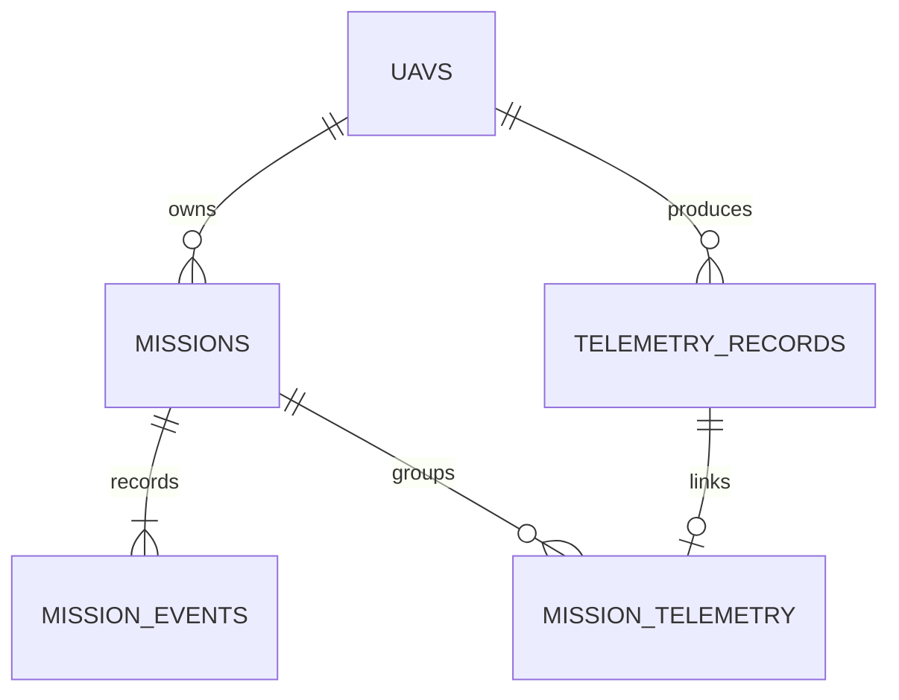

# Phase 5.5: UAV and mission records

Status: Implemented and locally tested; Windows regression and deployment
verification are pending when this patch is delivered.

Baseline: commit `faf415d`, identity database schema 8. This increment upgrades
to schema 9. It retains the existing UAV registry, status and assignment services.

## Checklist mapping

| Stage 5.5 requirement | Implementation |
|---|---|
| Registered UAV information | Existing `uavs` registry and Phase 4 administration services |
| UAV status and assignment records | Existing registry/assignment services with authorization and audit events |
| Mission ID and details | UUID mission ID, UAV, name, description and bounded JSON metadata |
| Start and end timestamps | Server-generated UTC microsecond timestamps on lifecycle transitions |
| Mission status | Planned, active, completed, aborted or cancelled |
| UAV/mission/telemetry relationships | Composite foreign keys and same-transaction association of new accepted records |
| Mission history retrieval | Authorized Python service and CLI with status/time filtering and pagination |

These are stored research/operational records. Creating or starting a record
does not upload a flight plan, arm a vehicle or dispatch a mission command.
Existing `mission.update` geofence/freshness authorization remains unchanged.

## Schema and relationships



`missions` contains `mission_id`, `uav_id`, `name`, `description`, `details_json`,
`status`, `created_at_us`, `created_by`, `started_at_us` and `ended_at_us`.
Each mission belongs to exactly one registered UAV. Multiple planned missions
are permitted, but a partial unique index permits at most one active mission
per UAV. Indexes support UAV/time queries.

`mission_events` stores the mission, known actor, time and each lifecycle event.
The mission service also appends a corresponding central `security_events` row
with category `mission`. The mutation, lifecycle event, central event and
successful authorization decision commit in one database transaction. Known
business-rule denials are audited without changing the mission. A storage error
rolls back the transaction and propagates; logging cannot be guaranteed during
a database outage.

`mission_telemetry` has one row per linked record, containing `record_id`,
`uav_id`, `mission_id` and `linked_at_us`. Composite foreign keys enforce that
the mission and telemetry belong to the same UAV. An index supports mission
retrieval. The existing telemetry payload/schema is unchanged.

## Lifecycle

- Create a mission: planned; no start or end time.
- Start a planned mission: active; start time is recorded.
- Complete or abort an active mission: terminal status; end time is recorded.
- Cancel a planned mission: cancelled; end time is recorded, start remains null.

Terminal records cannot restart. Invalid transitions and a second active mission
are denied. Server-clock regressions cannot place a start before creation or an
end before the start/latest linked receive time. Heartbeat loss does not
silently complete a mission. An authorized user must close its stored record.

## Telemetry association semantics

An `AFTER INSERT` trigger links a newly stored accepted record only when:

1. There is an active mission for that record's UAV.
2. The capture and GCS receive times are on or after the mission start.
3. Capture time does not exceed receive time.

All four supported message types may link: HEARTBEAT, GLOBAL_POSITION_INT,
SYS_STATUS and BATTERY_STATUS. The trigger executes inside the existing GCS
registry/history transaction. A link storage failure prevents the success
acknowledgement and rolls back history, snapshots and related transaction data.

Historical records predating schema 9 remain unchanged and unlinked. No mission
is invented for the earlier 11,694-record trial. Records received while no
mission is active, older-than-start records, future-dated captures and records
arriving after closure remain in UAV history without a mission association.
There is no manual reassignment or historical-import endpoint in this increment.
An identical record retry does not create another link or move a record into a
later mission. Existing associations cannot be updated.

Association is based on trusted gateway-attested record timing and the local
stored mission lifecycle. It is not evidence that the flight controller executed
a mission, nor independent cryptographic proof of a mission ID in MAVLink.

## Authorization and interfaces

Every service operation checks the current session, account, role permission,
active UAV and explicit UAV assignment in the same write transaction as the
operation. Even administrators require assignment under the existing policy.

| Operation | Existing permission | Default eligible roles |
|---|---|---|
| Create/start/complete/abort/cancel | command.request | Administrator, Operator |
| List/get mission metadata/history | status.read | Administrator, Operator, Viewer |
| Read linked telemetry | telemetry.read | Administrator, Operator, Viewer |

Eligibility also requires the session/account/UAV/assignment checks above. Role,
assignment, account or UAV changes apply on the next request. History remains
stored when access is denied; this increment preserves the existing rule that
inactive UAVs are not accessible through the user-facing resource service.
There is no user-facing mission deletion or audit editing operation.

The backend is `backend.missions.mission_service.MissionService`:

- `create(token, uav_id, name, description='', details=None)`
- `transition(token, uav_id, mission_id, operation)`
- `get(token, uav_id, mission_id)`
- `history(token, uav_id, status=None, start=None, end=None, limit=100, before=None)`
- `telemetry(token, uav_id, mission_id, start, end, limit=100, cursor=None)`

Optional arguments above are keyword arguments. History filters use mission
creation time; telemetry filters use capture time. Both time ranges are
half-open: start inclusive, end exclusive. List pagination returns
`next_before=[created_at_us,mission_id]`; telemetry uses the existing
`next_cursor` string. Maximum page size is 1,000. SQL values are parameterized.
Names/descriptions/JSON are bounded, non-finite JSON numbers are rejected and
mission identifiers are validated. Keep passwords, keys and other secrets out
of free-form mission details.

These are Python/CLI backend interfaces. This patch does not add a deployed HTTP
API, Vercel integration or new Streamlit controls.

## Deployment and CLI

Keep the active database at
`/home/eshra/.sentinel-phase5-data/identity.sqlite3` on the Linux filesystem.
Stop gateways, use SQLite's backup API to create a verified schema-8 backup,
then initialize with the WSL Python environment. Never concurrently open that
active file with native Windows SQLite. The old Windows database remains a
separate copy.

After backup, this one-line Windows command initializes schema 9:

```bat
wsl -d Ubuntu --cd /mnt/c/Users/eshra/Downloads/SENTINEL-UAV/SENTINEL-UAV /home/eshra/.venvs/sentinel-uav-phase2/bin/python -m database.identity_database --database /home/eshra/.sentinel-phase5-data/identity.sqlite3
```

List stored missions (enter the administrator password privately):

```bat
wsl -d Ubuntu --cd /mnt/c/Users/eshra/Downloads/SENTINEL-UAV/SENTINEL-UAV /home/eshra/.venvs/sentinel-uav-phase2/bin/python -m backend.missions.mission_service --database /home/eshra/.sentinel-phase5-data/identity.sqlite3 --uav-id e52be85d214d471291bae1b8a320cae6 list --limit 5
```

An initially empty list is expected. To create one planned record:

```bat
wsl -d Ubuntu --cd /mnt/c/Users/eshra/Downloads/SENTINEL-UAV/SENTINEL-UAV /home/eshra/.venvs/sentinel-uav-phase2/bin/python -m backend.missions.mission_service --database /home/eshra/.sentinel-phase5-data/identity.sqlite3 --uav-id e52be85d214d471291bae1b8a320cae6 create --name "Phase 5 storage validation" --description "Local mission-record verification"
```

Save the returned mission ID. Replace the subcommand with
`get --mission-id ID`, `start --mission-id ID`, `complete --mission-id ID`,
`abort --mission-id ID` or `cancel --mission-id ID` as appropriate.
Use `--username operator1` or `--username viewer1` before the subcommand to test
another account. For telemetry, use
`telemetry --mission-id ID --from-time ISO_TIME --to-time ISO_TIME` and optionally
`--limit`/`--cursor`. Creating a planned record does not require a running SITL.
A planned verification record can be cancelled afterward.

## Validation and limits

Local verification: 160 tests and 72 subtests passed, including 20 new tests.
The archive omits `phase4_access_app.py`, so its two existing UI integration tests
are excluded locally. Run the complete Windows suite before deployment approval.

New checks cover schema-8 preservation/idempotence, full migration rollback,
create/start/complete/abort/cancel, restart persistence, current role/session/
assignment enforcement, inactive UAVs, concurrency, one-active-mission limits,
clock regression, SQL literals and invalid inputs, bounded pagination and time
ranges, cross-UAV constraints, late/future/duplicate records, association
immutability, wrong signing identity and transaction rollback.

Real loopback mTLS tests verify an accepted record is persisted and linked before
acknowledgement, survives service restart, and receives no success acknowledgement
if mission-link storage fails. These are automated local fixtures, not a new
live SITL trial or wireless benchmark. The earlier live trial validates the
pre-existing telemetry path; a live mission-association claim requires a future
controlled trial with updated credentials.

Phase 5 still requires incident management, managed backup/restore and retention,
remaining interface/error-path coverage, reliability/performance work and final
acceptance documentation.
