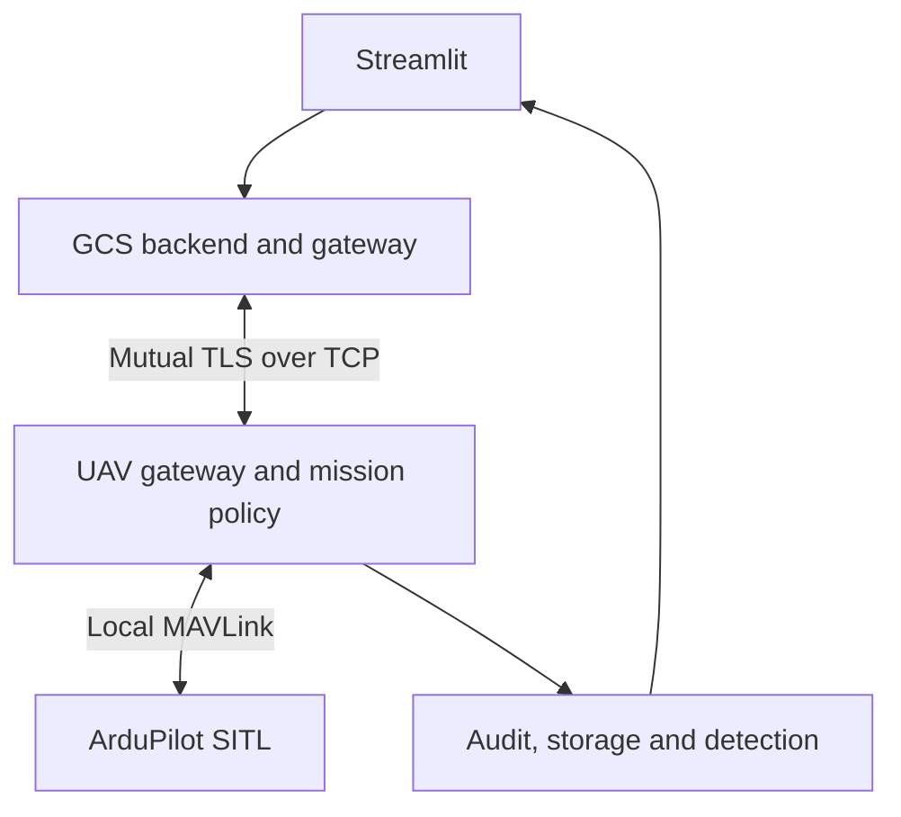

# System architecture

The GCS backend authenticates the operator and checks mission permissions.
The UAV gateway makes the final authorization decision using gateway
identity, trusted operator context carried over the protected channel,
and the latest qualifying SITL position. Streamlit reads backend state.
An independent process owns the MAVLink connection.

Plaintext exists at the gateways and on the local SITL leg. Restrict that
leg to local or otherwise isolated connectivity. Detection consumes
telemetry metadata and security events and raises alerts for review.
